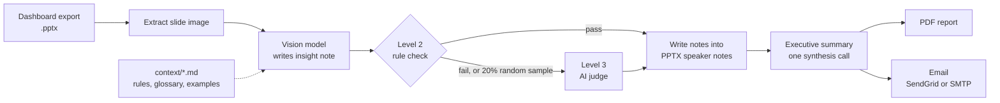

# PPTX Insights Generator

Drop in a dashboard export (`.pptx`, one picture per slide), run one command, and a vision model writes a structured insight note for every slide into the **speaker notes**. The tool then checks the notes for quality, writes an executive summary, and produces a PDF report and an optional email.


## How it works



Each slide is analysed on its own, so one bad slide never affects the others.

### Quality gates

| Level | What it does | Cost |
|---|---|---|
| 2: rule-based | required `Watch:` and `Action:` sections, bullets of at most 12 words, no hedge words such as "probably", at least one known abbreviation | free, every slide |
| 3: AI judge | a second model call scores accuracy, format and tone from 1 to 5 | extra call, on every Level 2 failure and on a random 20% of passes |

Neither level blocks the output. They flag problems in the printed quality report.

## Setup

**Prerequisites:** Python 3.11+, an Azure OpenAI resource with a vision-capable chat deployment. SendGrid or SMTP credentials are optional.

```bash
pip install -r requirements.txt
```

Create `.env` in the project root (it is git-ignored). Do not put quotes around the values.

```
AZURE_OPENAI_KEY=...
AZURE_OPENAI_ENDPOINT=https://<your-resource>.openai.azure.com/
AZURE_OPENAI_DEPLOYMENT=<your deployment name>

# Optional: email the report (leave out to skip)
EMAIL_PROVIDER=sendgrid        # or smtp
SENDGRID_API_KEY=...
REPORT_EMAIL_FROM=...
REPORT_EMAIL_TO=...
# SMTP alternative: SMTP_HOST, SMTP_PORT, SMTP_USER, SMTP_PASSWORD
```

## Run

```bash
python pptx_insights.py --input input/report.pptx --output output/report.pptx
```

| Output | Location |
|---|---|
| Annotated deck, insights in speaker notes | `output/report.pptx` |
| PDF report with all insights and the executive summary | `output/report_insights.pdf` |
| Email with both attached | sent to `REPORT_EMAIL_TO`, skipped if unset |

## Make it yours

The behaviour is driven by editable text, not code:

- **`context/*.md`** is loaded into the system prompt in filename order. Put your reporting rules, glossary and style examples there. The two shipped files are templates with fictional examples.
- **`modules/config.py`** holds the slide prompt, the abbreviation list used by the Level 2 check, the hedge-word list and `SAMPLE_RATE`. Keep `ABBREVIATIONS` in sync with your glossary.
- The note format (emoji markers 📍 📊 ▲ ▼ ⚠️ 🎯) is parsed by `modules/utils.py` to build the PDF and email. If you change the format in `SLIDE_PROMPT`, update the parsers too.

## Project layout

```
pptx_insights.py        entry point and orchestration
modules/
  config.py             prompts and constants
  context.py            loads context/*.md, builds the system prompt
  slides.py             image extraction, vision call, speaker notes
  evaluation.py         Level 2 rules and Level 3 AI judge
  summary.py            executive summary
  pdf_report.py         A4 PDF (fpdf2)
  email_report.py       HTML email via SendGrid or SMTP
  utils.py              parsing helpers
context/                your reporting rules and examples (templates included)
tests/                  unit tests for the rule checks and context loading
```

## Tests

```bash
python -m unittest discover -s tests -v
```

The tests cover the Level 2 rules and context loading. They need no API access.

## Limitations

- Decks must have one embedded picture per slide. Slides without a picture are skipped.
- The PDF looks for the free Inter font in `assets/fonts/` (`Inter-Regular.otf`, `Inter-Medium.otf`, `Inter-SemiBold.otf`, `Inter-Bold.otf`, which you download yourself) and otherwise falls back to DejaVu Sans from `/usr/share/fonts`. On Windows and macOS, add the Inter files.
- An optional `assets/logo.png` appears in the PDF footer.
- The model calls, PDF and email paths are not covered by automated tests, and there is no sample deck in the repository.
- Dependencies are pinned in `requirements.txt` but were not re-resolved for this repository.

## Privacy

Slide images are sent to your Azure OpenAI deployment. Keep decks and reports out of git: `input/`, `output/`, `*.pptx` and `*.pdf` are ignored. Do not put confidential figures in `context/` files that you commit.

## License

[MIT](LICENSE)
